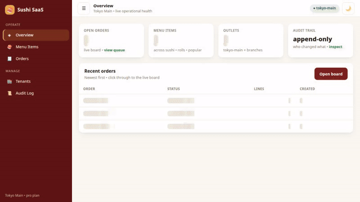
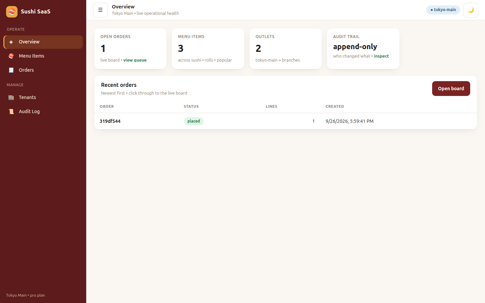
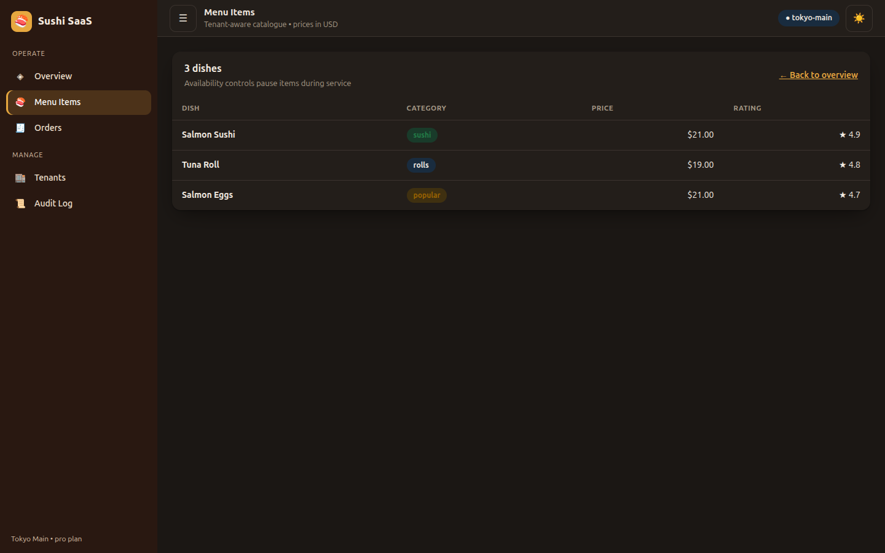
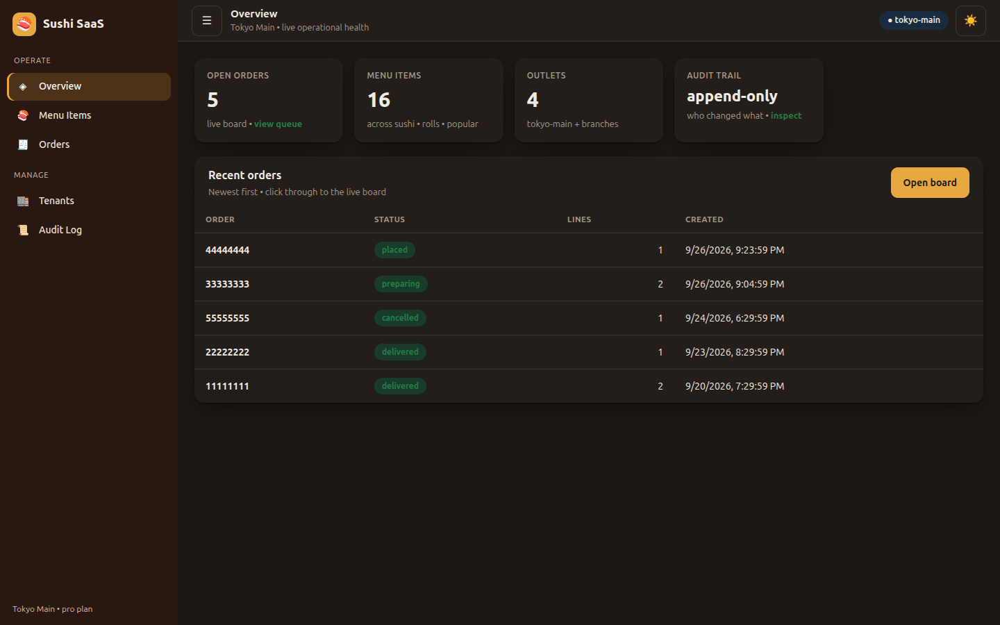
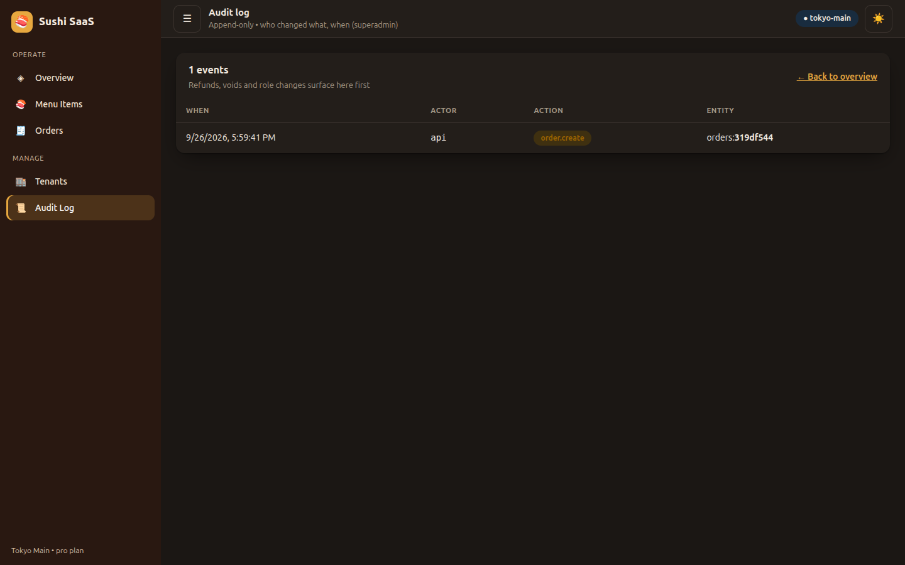
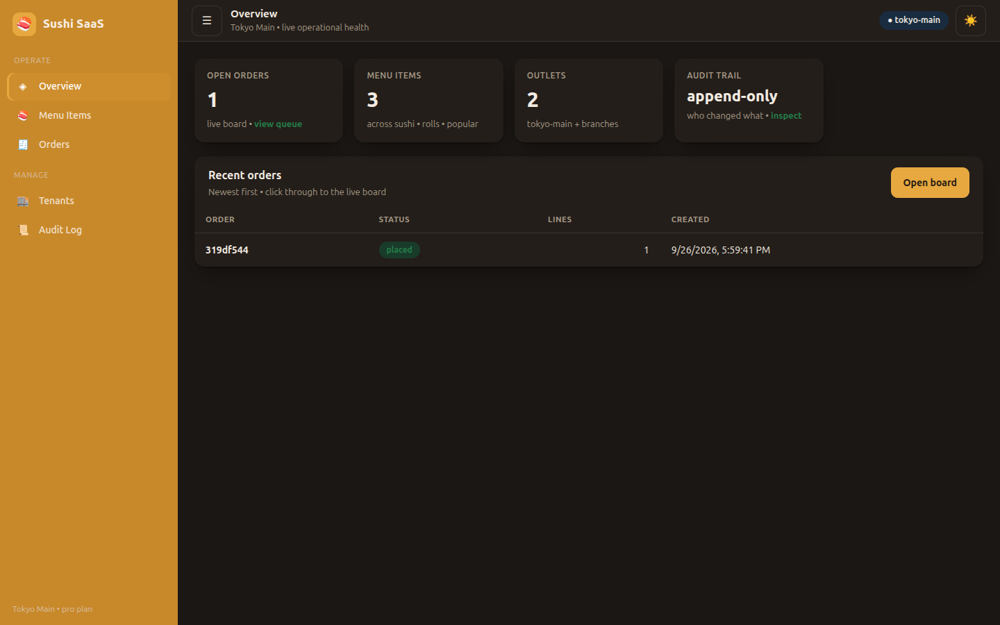

# 🖥️ Sushi Man — Admin Panel (Next.js + Refine)

> Run every outlet from one calm screen: live KPIs, menu, order board, outlets, audit — light and dark, phone to desktop.



*Full video: [`../docs/videos/demo-admin.mp4`](../docs/videos/demo-admin.mp4) · Screens below are Playwright captures against live backend data.*

| Overview (live KPIs) | Menu (pills, tabular prices) |
|---|---|
|  |  |

| Rich seed (5 orders · 16 dishes · 4 outlets) | Audit trail |
|---|---|
|  |  |

Dark mode included: 

Part of [Sushi Man SaaS](../README.md) — see the root README for the full stack, demo dataset and test matrix.

## Features

- Sidebar shell (256px → 68px, persisted), grouped nav, tenant pill, persisted theme toggle
- Overview: clickable KPI cards (orders/menu/outlets/audit) + recent-orders table
- Menu / Orders / Tenants / Audit tables: sticky headers, status & category pills, skeleton loaders, empty states, error retry
- RBAC permission keys (`lib/permissions.ts`): `menu.write`, `orders.refund`, `support.impersonate`, `export.customer_pii`
- Refine headless data layer (`lib/dataProvider.ts`) over the NestJS API; tenant-scoped on every request

## Quick start

```bash
npm install
NEXT_PUBLIC_API_URL=http://localhost:3001 npm run dev -- -p 3102
```

Production (standalone, non-root Docker):

```bash
npm run build && npm start -- -p 3002
```

> `NEXT_PUBLIC_*` is baked at build time — browsers can't resolve `backend:3001`, so the Docker build passes `ADMIN_API_URL` (default `http://localhost:3001`; use your public API domain in cloud).

## Configuration

| Option | Default | Description |
|---|---|---|
| `NEXT_PUBLIC_API_URL` | `http://localhost:3001` | Backend API (build-time) |
| `PORT` | `3002` | Server port (runtime) |

## Testing

```bash
# from sushi-shop-saas/tests/playwright:
npx playwright test --project=admin-chromium   # 6 E2E: KPIs, menu, orders, tenants, audit, nav
npx playwright test --project=demo-admin       # recorded video tour → docs/videos/
```

## Structure

```
app/page.tsx            # overview (KPIs + recent orders)
app/admin/menu|orders|tenants|audit/page.tsx
app/api/health/route.ts # container healthcheck
components/Shell.tsx    # sidebar + topbar + theme/collapse
lib/permissions.ts      # stable RBAC action keys
lib/dataProvider.ts     # Refine provider over the REST API
app/globals.css         # design tokens, tables, pills, dark mode
next.config.ts          # output: standalone
Dockerfile              # deps/builder/runner, non-root, healthcheck
```
