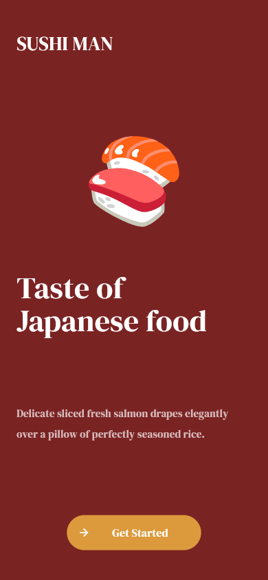
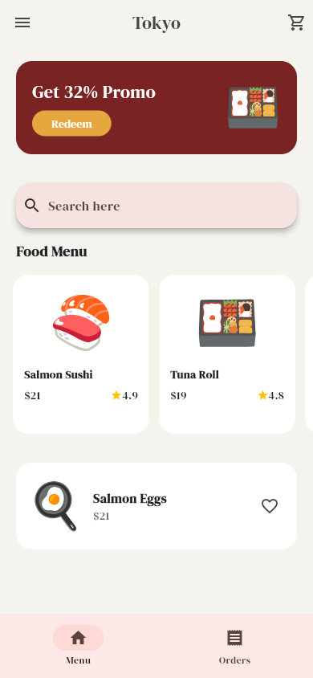
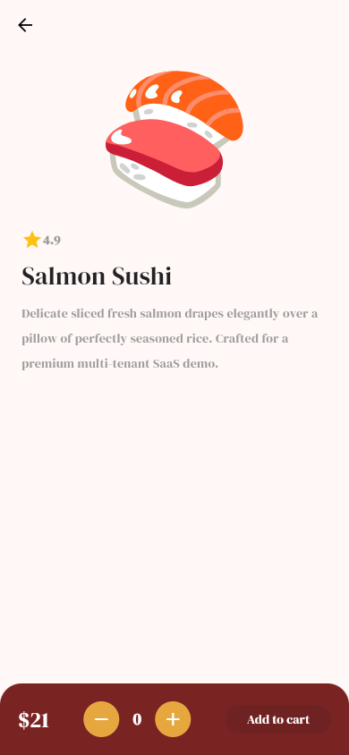
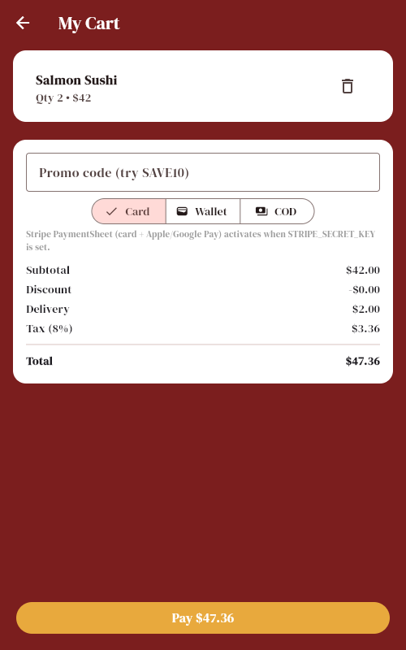

# 📱 Sushi Man — Customer App (Flutter)

> Order sushi in minutes: promo, search, favorites, details, cart with checkout math, reorder — on iOS, Android and Web from one codebase.


*Full video: [`../docs/videos/demo-app.mp4`](../docs/videos/demo-app.mp4) · Screens below are Playwright captures of the real app.*

| Intro | Menu (12 dishes) |
|---|---|
|  |  |

| Details (stepper, Hero) | Checkout (SAVE10 + Card/Wallet/COD) |
|---|---|
|  |  |

Part of [Sushi Man SaaS](../README.md) — see the root README for the full stack, demo dataset and test matrix.

## Features

- Intro with brand typography (DM Serif) + Get Started
- Promo banner — **Redeem** applies `SAVE10` straight into checkout
- Live search with empty-state guidance; favorites with persistence
- Horizontal menu tiles (Hero → details), popular pick with favorite heart
- Details: rating, description, quantity stepper (never negative, fixed-width count), Add to cart + success dialog + double-pop back to menu
- Cart: swipe-to-delete, promo field, checkout math (subtotal − discount + delivery + 8% tax), Card/Wallet/COD selector, order history + one-tap reorder
- Responsive: bottom `NavigationBar` on phones, `NavigationRail` on desktop (tested at 390×844 and 1280×800)

## Quick start

```bash
flutter pub get
flutter run -d web-server --web-port 8081   # web
flutter run                                  # iOS / Android device
```

Production bundle (what Docker ships):

```bash
flutter build web --release
```

## Configuration

| Option | Default | Description |
|---|---|---|
| API base | baked demo menu | Currently serves the bundled Tokyo menu; point checkout at `http://localhost:3001` to go live |
| Promo | `SAVE10` = 10% off | Banner Redeem prefills it; editable in cart |

## Testing

```bash
flutter analyze   # expect: No issues found
flutter test      # 7 tests: nav, qty, search, cart math, redeem prefill, 2× responsive breakpoints
```

## Structure

```
lib/main.dart         # all screens (Intro/Menu/Details/Cart) + Riverpod providers
test/widget_test.dart # behavior-first widget tests incl. breakpoint tests
Dockerfile.web        # nginx + prebuilt bundle (fast) — .full builds from scratch
nginx.conf            # SPA fallback + immutable asset caching
```
